  

### Hi, I'm Pranesh

I'm **Pranesh Bandiya**, a student at **IIT Bombay**. I build full-stack applications and machine-learning projects, with an interest in the complete path from data and models to usable software.

My repositories include local study tools, computer-vision experiments, reinforcement-learning environments, and constrained pricing analysis. I keep setup instructions, evaluation evidence, and limitations alongside the code.

### Selected projects

| Project | What it does | Stack |
|---|---|---|
| [LearnPath Study Planner](https://github.com/CodeAcc2007-dev/learnpath-study-planner) | A local course workspace for playlists, lessons, practice, and study progress | React · TypeScript · FastAPI · SQLite |
| [Facial Expression Recognition](https://github.com/CodeAcc2007-dev/facial-expression-recognition) | Duplicate-safe ResNet-18 experiments and probability ensembling; **67.86% saved validation accuracy** | PyTorch · torchvision · pandas |
| [Retail Price Optimization](https://github.com/CodeAcc2007-dev/retail-price-optimization) | Interpretable demand modelling and constrained pricing for a **49-SKU simulated retail case** | Python · pandas · SciPy |
| [Traffic Sign Classifier](https://github.com/CodeAcc2007-dev/WiDS-Traffic-Sign-Classifier) | A 43-class CNN for GTSRB; **97.70% recorded notebook test accuracy** | TensorFlow · Keras · scikit-learn |
| [RL Arena](https://github.com/CodeAcc2007-dev/RL-Arena-SoC) | Pygame grid games, a custom Gymnasium maze, and PPO training | Pygame · NumPy · Stable-Baselines3 |
| [Tutorial Quality Scorer](https://github.com/CodeAcc2007-dev/tutorial-quality-scorer) | A regression exercise on **synthetic** tutorial metadata, with baseline comparisons | scikit-learn · pandas · Matplotlib |

The repositories explain which results are recorded experiments, validation measurements, or simulated scenarios. Expression-category predictions do not establish a person's emotional state; synthetic tutorial scores do not measure real teaching quality.

### 🔭 What I'm building right now

<table>
  <tr>
    <td width="90" align="center" valign="top"><h2>🚀</h2></td>
    <td valign="top">
      <b><a href="https://github.com/CodeAcc2007-dev/KRNLv3">KRNL</a></b> — a live campus email &amp; deadline intelligence PWA for IIT Bombay students. 
      It sorts your inbox, extracts deadlines automatically, and lets you ask your mail questions in plain English. 
       
      <code>FastAPI</code> &nbsp;<code>React</code>&nbsp; <code>Qdrant</code> &nbsp;<code>Celery</code>&nbsp; <code>Supabase</code>
      &nbsp;&nbsp;•&nbsp;&nbsp; <a href="https://krnlv3.vercel.app"><b>Live&nbsp;app&nbsp;→</b></a>
    </td>
  </tr>
</table>

### Tools I work with

**Languages:** Python, TypeScript, JavaScript, C++  
**Applications:** React, Vite, FastAPI, SQL, SQLite  
**Machine learning:** PyTorch, TensorFlow/Keras, NumPy, pandas, scikit-learn  
**Workflow:** Git, Linux, reproducible experiments, documented setup

### Connect

[LinkedIn](https://www.linkedin.com/in/pranesh-bandiya-985398370/) · [Email](mailto:praneshbandiya@gmail.com)

  

